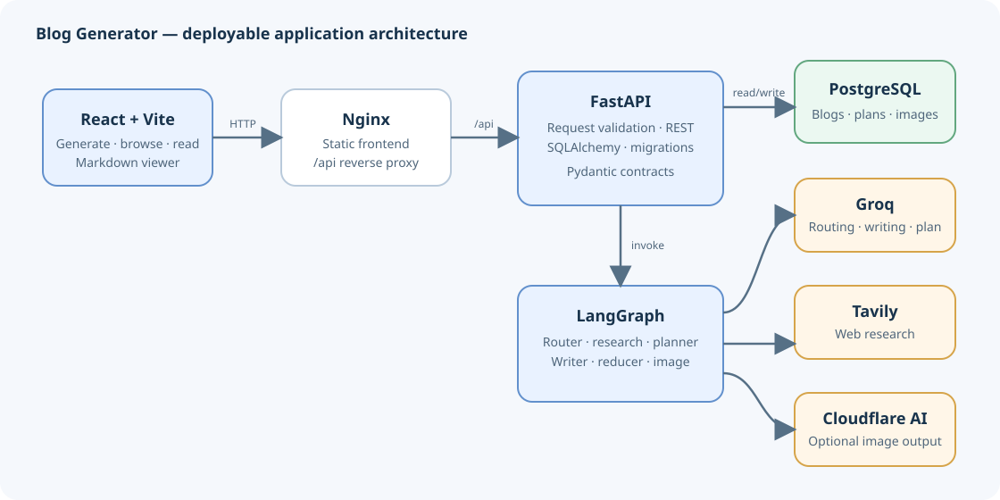
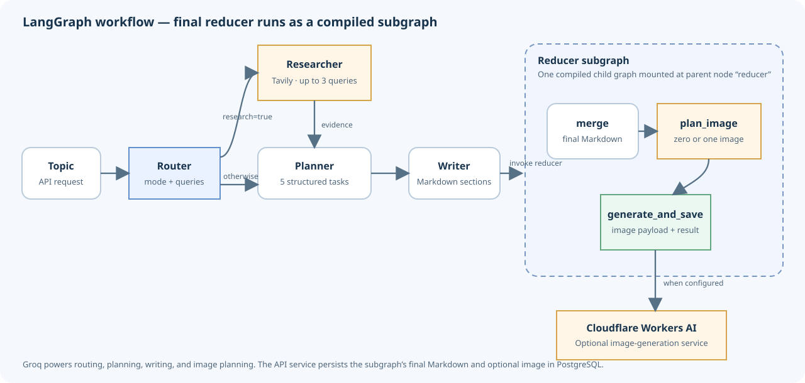

# Blog Generator

A deployable blog-generation application built from the workflow in
[`../blog writing agent/4_bwa_image.ipynb`](<../blog%20writing%20agent/4_bwa_image.ipynb>).
The notebook is the original reference and is not changed by this project.

The application provides a React/TypeScript interface, a FastAPI service that
runs the LangGraph workflow, and PostgreSQL persistence for generated blogs,
plans, citations, generation warnings, and optional generated image data.

## Why FastAPI?

Yes. FastAPI is the backend/API layer between the browser and the Python
workflow. It validates requests, keeps provider credentials on the server,
invokes LangGraph, persists results through SQLAlchemy, and exposes a typed API
for the React app. A browser must not call Groq, Tavily, Cloudflare, or
PostgreSQL directly: doing so would expose secrets and couple the UI to
provider-specific APIs.

## Features

- Research routing chooses `closed_book`, `hybrid`, or `open_book`.
- Optional Tavily research is limited to three queries and four deduplicated
  evidence items, matching the reference workflow.
- Groq structured output creates a five-section plan; each task supports three
  to five concise bullets.
- A writer creates the planned sections, then a compiled reducer subgraph runs
  `merge → plan_image → generate_and_save`.
- The image planner may request zero or one image. Cloudflare Workers AI image
  generation is optional; an image failure is recorded as a warning and does
  not discard an otherwise successful blog.
- PostgreSQL stores blog content, plan, evidence, warnings, and the optional
  image as a separate related entity.
- The UI streams workflow progress and the generated Markdown, browses saved
  blogs, shows the plan and evidence, and supports Markdown/image downloads.
  Markdown is rendered with raw HTML disabled.
- A dark/bright theme toggle remembers the user's preference. The existing
  bright theme remains the default.
- Docker Compose starts PostgreSQL, the API, and an Nginx-served React app.
- Alembic migrations manage the database schema.

## Architecture





### Request lifecycle

1. React posts a topic to `POST /api/v1/blogs/stream` and receives
   newline-delimited JSON progress/content events. The existing
   `POST /api/v1/blogs` endpoint remains available to clients expecting a
   single JSON response.
2. FastAPI validates the topic and invokes the graph.
3. The router selects whether research is needed. Research results are fed to
   the planner as evidence; they are not treated as verified facts.
4. The planner returns a structured five-section plan. The writer produces
   Markdown for the sections.
5. The reducer subgraph merges the content, plans an optional image, and
   attempts Cloudflare image generation when an image was planned and configured.
6. FastAPI commits the blog and optional image to PostgreSQL, then emits the
   saved blog in the `complete` event. The non-streaming endpoint returns the
   same saved-blog representation as JSON.
7. React displays the completed draft; selecting a saved item later loads it
   using `GET /api/v1/blogs/{id}`.

The streaming endpoint emits newline-delimited JSON events: `progress` for
workflow stages, `plan` when the outline is ready, `content` as the writer
produces Markdown chunks, and `complete` after the blog has been persisted.
Failures are sent as an `error` event because the response has already begun.
The original JSON endpoint remains available and unchanged.

The reducer is compiled independently using its own `ReducerState` and is
mounted as the `reducer` node in the parent graph. It exposes the workflow
values it needs (`topic`, `plan`, and `markdown_sections`) plus its reducer
results (`draft_markdown`, `image_plan`, image metadata/bytes, and warnings).
The `generate_and_save` graph node prepares the final Markdown and image
payload; the application service persists both to PostgreSQL after the graph
finishes, rather than writing generated assets to the API container filesystem.

## Project layout

```text
blog-generator/
├── backend/
│   ├── alembic/                  # Versioned PostgreSQL schema migrations
│   ├── app/
│   │   ├── agents/               # LangGraph state, graph, and workflow prompts
│   │   ├── api/routes/           # HTTP endpoints and dependency wiring
│   │   ├── core/                 # Configuration and logging
│   │   ├── db/                   # SQLAlchemy base, engine, and sessions
│   │   ├── models/               # Blog and generated-image entities
│   │   ├── schemas/              # Workflow and HTTP request/response models
│   │   └── services/             # Generation orchestration and persistence
│   ├── tests/
│   ├── Dockerfile
│   ├── alembic.ini
│   ├── requirements.txt
│   └── requirements-dev.txt
├── docs/
│   ├── architecture.svg
│   └── agent-workflow.svg
├── frontend/
│   ├── src/
│   ├── Dockerfile
│   ├── nginx.conf
│   └── package.json
├── .env.example
└── docker-compose.yml
```

## Requirements

- Docker Desktop with Docker Compose v2 (recommended deployment path).
- Groq API key for generation.
- Tavily API key for research. If not configured, research-dependent requests
  fail clearly rather than silently using empty evidence.
- Cloudflare account ID and Workers AI API token for optional image generation.
- Node.js 20+ and Python 3.12+ only for local development outside Docker.

## Configure and run with Docker Compose

From this directory:

```powershell
Copy-Item .env.example .env
```

Edit `.env` and set a unique strong `POSTGRES_PASSWORD`, a matching
`DATABASE_URL` using `postgresql+psycopg://...@db:5432/blog_generator`, and
`GROQ_API_KEY`. Supply `TAVILY_API_KEY` and both
Cloudflare values to enable research and image generation, respectively.
Cloudflare values are optional; image generation is skipped with a warning if
credentials are missing. Research keys are required only when the router
decides the topic needs research.

Start the stack:

```powershell
docker compose up --build -d --remove-orphans
```

`--remove-orphans` removes the earlier `api` service container from this
Compose project after it was renamed to `blog-api`; it does not remove the
PostgreSQL volume.

Open the frontend at [http://localhost:8080](http://localhost:8080). With the example
`APP_ENV=development`, the API documentation is available at
[http://localhost:8080/api/docs](http://localhost:8080/api/docs) (the Nginx proxy forwards `/api` to FastAPI).
The API is also reachable directly at [http://localhost:8001](http://localhost:8001)
for local diagnostics. The container listens on port `8000`; `API_PORT` only
selects the loopback host port and defaults to `8001`.
Set `APP_ENV=production` for deployment to disable interactive API docs. The
API container runs `alembic upgrade head` before starting.

Stop the stack while keeping the database volume:

```powershell
docker compose down
```

Remove the development database and its saved blogs only when you explicitly
want to erase them:

```powershell
docker compose down --volumes
```

The frontend, API, and PostgreSQL host ports are bound to `127.0.0.1` by
default. Nginx proxies `/api/` requests to the dedicated `blog-api` service
over a project-specific Compose network; it does not use the host-published
port. PostgreSQL remains on port `5432` inside Docker while `POSTGRES_PORT`
defaults to host port `5433`, avoiding a local PostgreSQL collision. For an
internet-facing deployment, terminate TLS at
an ingress, add authentication/authorization in front of the app, and configure
network restrictions; this starter does not implement user accounts.

## Local development

Start PostgreSQL (for example, run `docker compose up -d db`; host port 5433 is
bound to loopback only), then create a virtual environment in `backend`,
install requirements, and set the environment variables from `.env.example`
(change the database URL host from `db` to `localhost` while keeping its port
at `5433`). Apply migrations and start the API:

```powershell
cd backend
python -m venv .venv
.\.venv\Scripts\Activate.ps1
pip install -r requirements-dev.txt
alembic upgrade head
uvicorn app.main:app --reload
```

In another terminal:

```powershell
cd frontend
npm ci
npm run dev
```

The local Vite dev server proxies `/api` to `http://localhost:8000`. The
development frontend is at [http://localhost:5173](http://localhost:5173); the API docs are at
[http://localhost:8000/api/docs](http://localhost:8000/api/docs).
This local Uvicorn port is configurable with `--port`; `API_PORT=8001` applies
only to the API container's host binding in Compose.

## Configuration

| Variable                  | Required    | Purpose                                                                 |
| ------------------------- | ----------- | ----------------------------------------------------------------------- |
| `DATABASE_URL`          | Yes         | SQLAlchemy PostgreSQL DSN; use `postgresql+psycopg://...`             |
| `POSTGRES_DB`           | Compose     | Database name for the PostgreSQL container                              |
| `POSTGRES_USER`         | Compose     | Database role for the PostgreSQL container                              |
| `POSTGRES_PASSWORD`     | Compose     | Database password; do not commit a real value                           |
| `POSTGRES_PORT` | No | Loopback-only host port for local database access; defaults to `5433` |
| `API_PORT` | No | Loopback-only host port for direct API access; defaults to `8001` |
| `GROQ_API_KEY`          | Yes         | Authentication for the Groq chat model                                  |
| `GROQ_MODEL`            | No          | Groq model name; defaults to `openai/gpt-oss-120b`                    |
| `TAVILY_API_KEY`        | Conditional | Required when a topic is routed to research                             |
| `CLOUDFLARE_ACCOUNT_ID` | No          | Enables the optional Cloudflare image API                               |
| `CLOUDFLARE_API_TOKEN`  | No          | Enables the optional Cloudflare image API                               |
| `TPM_BUDGET`            | No          | Per-process rolling request-token budget; defaults to `7600`          |
| `MAX_IMAGE_BYTES`       | No          | Maximum image accepted for PostgreSQL storage; defaults to 10 MiB       |
| `CORS_ORIGINS`          | No          | Comma-separated origins allowed to call the API                         |
| `APP_ENV`               | No          | `development` enables the interactive OpenAPI docs                    |
| `LOG_LEVEL`             | No          | Python logging level                                                    |

Keep `.env` out of source control. For a real deployment, provide secrets
through the hosting platform's secret manager, use TLS at the ingress, restrict
database network access, and configure backups, monitoring, and provider
quotas. Do not expose the database port publicly.

## HTTP API

The API is versioned under `/api/v1`.

| Method     | Endpoint                            | Description                             |
| ---------- | ----------------------------------- | --------------------------------------- |
| `POST`   | `/api/v1/blogs`                   | Generate and persist a blog             |
| `GET`    | `/api/v1/blogs?limit=20&offset=0` | List saved blogs, newest first          |
| `GET`    | `/api/v1/blogs/{blog_id}`         | Read a saved blog and its plan/evidence |
| `GET`    | `/api/v1/blogs/{blog_id}/image`   | Fetch the optional stored image         |
| `DELETE` | `/api/v1/blogs/{blog_id}`         | Delete a saved blog and its image       |
| `GET`    | `/healthz`                        | Liveness check                          |
| `GET`    | `/readyz`                         | Database readiness check                |

Example:

```powershell
Invoke-RestMethod `
  -Method Post `
  -Uri http://localhost:8000/api/v1/blogs `
  -ContentType 'application/json' `
  -Body '{"topic":"Practical database indexing for application developers"}'
```

The generation endpoint is synchronous: the HTTP request remains open while
the external research/model/image providers are called. Put the API behind a
proxy with suitable request timeouts. For higher traffic or long generation
times, move graph execution to a durable job queue and return a job ID; the
current deployment is a single API service and its rolling token limiter is
process-local.

## Database and retention

The `blogs` table stores the topic, final Markdown, plan JSON, evidence JSON,
generation warnings, and timestamps. `blog_images` stores optional image bytes
separately with a one-to-one foreign key. Images are size-limited by
`MAX_IMAGE_BYTES`. Blog deletion cascades to its image. PostgreSQL data resides
in the named `postgres_data` volume. Back up that volume or use a managed
PostgreSQL backup service before upgrading or moving deployments.

Schema changes belong in Alembic revisions. Do not use `create_all` in
production to make schema changes.

## Tests and quality checks

Backend tests use pytest:

```powershell
cd backend
pip install -r requirements-dev.txt
pytest
```

Frontend checks:

```powershell
cd frontend
npm ci
npm run build
```

The tests use mocked model/search clients and do not require provider API keys.
PostgreSQL integration tests require a reachable test database and
`TEST_DATABASE_URL`.

## Workflow fidelity and production notes

The application separates the notebook's concerns into reusable modules
without importing or editing the notebook. It retains the routing modes,
bounded Tavily query/evidence collection, five-task plan, Markdown writing,
single optional image plan, and image-failure warning behavior.

The in-memory token budget protects requests only within one running API
process; it is not a distributed quota manager. Run one API replica or replace
it with a shared limiter when horizontal scaling is needed. Generation is not
currently resumable if the API process stops mid-request. Add a durable queue
and a LangGraph checkpoint store before treating long-running generations as
background jobs.
